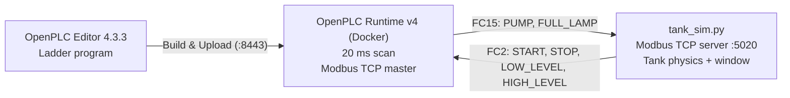

# Water Tank Simulation Control Using Ladder Logic via Modbus TCP


A PLC-controlled water tank built with **ladder logic** in **OpenPLC**. The ladder program runs in **OpenPLC Runtime v4** and controls a **virtual water tank** written in Python.

The simulator behaves like a real **Modbus TCP remote I/O module**. It sends the push buttons and float switches to the PLC, and it switches the pump and the tank-full lamp from the PLC's outputs. The PLC sees it exactly as it would see field hardware.

---

## Highlights

- **Ladder logic (IEC 61131-3 LD).** A start/stop seal-in latch plus two-level pump control with hysteresis.
- **Real remote I/O architecture.** OpenPLC is the Modbus TCP master and polls the simulator on port 5020 every 100 ms.
- **Modbus TCP server written from scratch.** Pure Python with no external libraries. It supports FC1–FC6, FC15 and FC16, with proper exception responses.
- **Fail-safe outputs.** If the PLC stops polling for 2 s, the simulator switches the pump and lamp off, just like a real I/O module on communication loss.
- **Live tank window.** It shows the water level, pump, inflow and outflow, float switches, lamps, and the PLC link with a request counter.
- **Disturbance testing.** An adjustable outflow valve and **Drain to 10 %** / **Reset to 50 %** buttons.
- **Headless mode** for automated testing without a window.

---

## System Architecture



| Port | Service | Client |
|---|---|---|
| `5020` | Tank simulator, Modbus TCP server (remote I/O) | OpenPLC Runtime (master) |
| `8443` | OpenPLC Runtime web interface | OpenPLC Editor |

---

## Repository Structure

```
├── WaterTank/                        OpenPLC Editor project
│   ├── project.json                    Project settings (task0, 20 ms cyclic)
│   ├── devices/configuration.json      Target: OpenPLC Runtime v4
│   ├── devices/remote/TankIO.json      Modbus TCP remote device → simulator
│   └── pous/programs/main.ld           Ladder program (3 rungs)
└── TankSimulator/                    Virtual water tank
    ├── tank_sim.py                     Tank physics, Modbus TCP server, tkinter window
    └── Start Tank.bat                  One-click start (Windows)
```

---

## Requirements

- Windows 10/11
- [Python 3.10+](https://www.python.org/). No extra packages are needed; tkinter comes with the standard Windows installer.
- [Docker Desktop](https://www.docker.com/products/docker-desktop/)
- [OpenPLC Editor 4.3.3 or newer](https://autonomylogic.com/) with OpenPLC Runtime v4. Runtime v4.3.x refuses uploads from older editors.

> **Why Runtime v4?** The editor's built-in simulator has no network access. Only the **OpenPLC Runtime v4** target supports Modbus TCP remote devices, where the PLC acts as Modbus master.

> **Tip:** Keep the project in a plain path such as `C:\PLC Project\`. Paths with non-ASCII characters or inside OneDrive can break the OpenPLC build.

---

## Getting Started

### 1. Start the tank simulator

Double-click **`TankSimulator/Start Tank.bat`**, or run:

```bash
cd TankSimulator
python tank_sim.py
```

The tank window opens and waits for the PLC on Modbus port **5020**.

### 2. Start OpenPLC Runtime (Docker)

On first use, create the container:

```bash
docker run -d --name openplc-runtime -p 8443:8443 --cap-add=SYS_NICE --cap-add=SYS_RESOURCE -v openplc-runtime-data:/var/run/runtime ghcr.io/autonomy-logic/openplc-runtime:latest
```

After that, start it with:

```bash
docker start openplc-runtime
```

### 3. Load the PLC program

1. Open the **`WaterTank`** folder in OpenPLC Editor.
2. The first time you connect, create a runtime user when the editor asks.
3. **Build & Upload** → **Play** (Start PLC).
4. The **PLC link** lamp in the tank window turns green and the request counter starts counting.

### 4. Run it

Press **START** in the tank window. The pump keeps the level between **20 %** and **85 %**. Move the **outflow valve** slider to change the water demand.

> The remote device `TankIO` points to `host.docker.internal:5020` because the runtime runs inside Docker. If you run OpenPLC natively, change the host to `127.0.0.1`.

---

## How It Works

### Control logic

- **START / STOP:** START latches `SYSTEM_ON` (seal-in contact). STOP breaks the latch.
- **Pump:** The pump starts when the water falls below the **LOW** float switch (20 %). Its own contact keeps it running (seal-in) until the water reaches the **HIGH** float switch (85 %). The gap between the two switches is the **hysteresis**, and it stops the pump from switching on and off rapidly.
- **Full lamp:** `FULL_LAMP` lights while the HIGH float switch is made.

### Ladder diagram

```
Rung 1: System start / stop latch
       START_BUTTON        STOP_BUTTON                    SYSTEM_ON
 ||---+-----| |-----+----------|/|---------------------------( )------||
 ||   |             |
 ||   +-----| |-----+
 ||      SYSTEM_ON

Rung 2: Pump control with hysteresis (20 % ON, 85 % OFF)
         SYSTEM_ON     LOW_LEVEL      HIGH_LEVEL            PUMP
 ||---+-----| |-----------|/|-----+-------|/|----------------( )------||
 ||   |                           |
 ||   +-----| |-----------| |-----+
 ||      SYSTEM_ON       PUMP

Rung 3: Tank full indicator
        HIGH_LEVEL                                        FULL_LAMP
 ||---------| |----------------------------------------------( )------||
```

| Rung | Boolean logic |
|---|---|
| 1 | `SYSTEM_ON = (START_BUTTON OR SYSTEM_ON) AND NOT STOP_BUTTON` |
| 2 | `PUMP = (SYSTEM_ON AND NOT LOW_LEVEL OR SYSTEM_ON AND PUMP) AND NOT HIGH_LEVEL` |
| 3 | `FULL_LAMP = HIGH_LEVEL` |

### A typical cycle (outflow valve at 40 %)

1. The tank starts at 50 % and the pump is off. The level drops by about 1 %/s.
2. Below 20 %, `LOW_LEVEL` goes FALSE, so the **pump starts**. The level rises by about 3 %/s (4 %/s in, 1 %/s out).
3. At 85 %, `HIGH_LEVEL` goes TRUE, so the **pump stops** and **FULL_LAMP** lights.
4. The tank drains again and the cycle repeats.

---

## I/O Map

Remote device **`TankIO`**: Modbus TCP, `host.docker.internal:5020`, slave ID 1, timeout 1000 ms, polled every 100 ms.

| Modbus | Function | OpenPLC address | Variable | Description |
|---|---|---|---|---|
| Discrete input 0 | FC2 | `%IX0.0` | `START_BUTTON` | Start push button (momentary) |
| Discrete input 1 | FC2 | `%IX0.1` | `STOP_BUTTON` | Stop push button (momentary) |
| Discrete input 2 | FC2 | `%IX0.2` | `LOW_LEVEL` | TRUE when the water is at or above 20 % |
| Discrete input 3 | FC2 | `%IX0.3` | `HIGH_LEVEL` | TRUE when the water is at or above 85 % |
| Coil 0 | FC15 | `%QX0.0` | `PUMP` | Supply pump |
| Coil 1 | FC15 | `%QX0.1` | `FULL_LAMP` | Tank-full lamp |
| *Internal* | | | `SYSTEM_ON` | System running (latch) |

The simulator also provides the **tank level** as input register 0 (FC4), in 0.1 % steps (0–1000). It's ready for an analog level display or a future HMI.

---

## Tank Simulator

### Physics

| Parameter | Value |
|---|---|
| Start level | 50 % |
| Pump inflow | +4 %/s |
| Outflow | Up to 2.5 %/s × valve opening (default 40 %) |
| LOW float switch | 20 % |
| HIGH float switch | 85 % |
| Communication timeout | 2 s; then the outputs drop to OFF |

### Window controls

- **START / STOP:** press-and-hold push buttons, like real momentary buttons
- **Outflow valve %:** slider from 0 to 100 %
- **Drain to 10 %** / **Reset to 50 %:** set the level instantly for testing
- Indicators for the pump, full lamp, both float switches and the PLC link

### Supported Modbus functions

| Code | Function |
|---|---|
| FC1 / FC2 | Read coils / read discrete inputs |
| FC3 / FC4 | Read holding registers / read input registers |
| FC5 / FC6 | Write single coil / write single register |
| FC15 / FC16 | Write multiple coils / write multiple registers |

Invalid requests get standard Modbus exception responses: 01 illegal function, 02 illegal address, 03 illegal value.

### Command-line options

```bash
python tank_sim.py [--port 5020] [--host 0.0.0.0] [--headless]
```

| Option | Default | Description |
|---|---|---|
| `--port` | `5020` | Modbus TCP port |
| `--host` | `0.0.0.0` | Address to listen on |
| `--headless` | off | No window; prints the level, pump and link status every second |

---

## Test Scenarios

| Test | Steps | Expected result |
|---|---|---|
| Normal cycle | Press START, valve at 40 % | The pump cycles between 20 % and 85 % |
| Stop | Press STOP while the pump runs | The pump stops at once and the latch is released |
| High demand | Set the valve to 100 % | The pump still fills the tank (+1.5 %/s net) |
| Low start | Press **Drain to 10 %**, then START | The pump starts immediately |
| Tank full | Let the level reach 85 % | The pump stops and FULL_LAMP turns on |
| Communication loss | Stop the PLC program in OpenPLC | After 2 s the pump and lamp switch off and the PLC link turns red |

---

## Troubleshooting

| Symptom | Fix |
|---|---|
| **PLC link** lamp stays red | Start Docker Desktop and the `openplc-runtime` container, then **Play** the program |
| Runtime log shows `Network is unreachable` to `host.docker.internal:5020` | The tank simulator is not running. Start it first |
| `WinError 10048` when starting the simulator | Port 5020 is already in use by another simulator window. Close it |
| Upload to the runtime is refused | Update OpenPLC Editor to 4.3.3 or newer |
| Build fails (`OpenPLCUserLib.h` not found) | Move the project to a path without non-ASCII characters (not inside OneDrive) |
| Pump doesn't start after START | The level is still above 20 %. Wait for it to drop, or press **Drain to 10 %** |

---

## Roadmap

- [ ] Show the analog tank level (input register 0) in the PLC program
- [ ] Dry-run alarm: the pump runs but the level doesn't rise
- [ ] HMI/SCADA front end over Modbus TCP
- [ ] Use the tank as the water supply for a bottling line (follow-up project)
